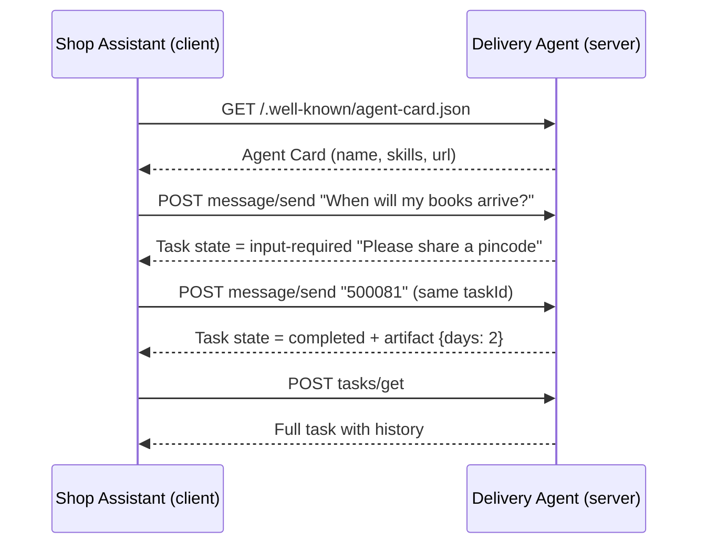
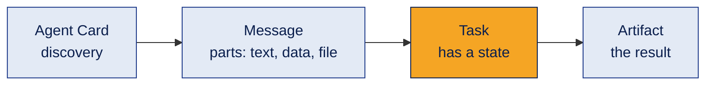
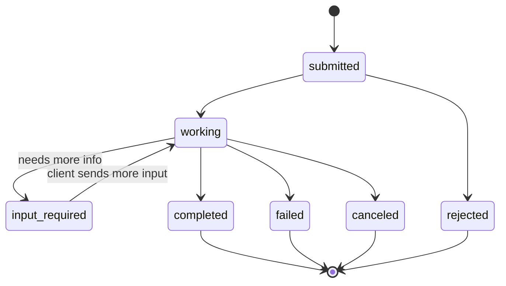

# A2A Protocol Demo: two agents talking

A small, runnable sample of the **A2A (Agent2Agent) protocol**. A Shop Assistant agent finds a Delivery Agent, asks it a question, gives more input when asked, and reads back a structured result.

It uses **only the Python standard library**. No API key, no installs.

## Contents
1. [What is A2A](#1-what-is-a2a)
2. [How it works](#2-how-it-works)
3. [The demo](#3-the-demo)
4. [Run it](#4-run-it)
5. [Task states](#5-task-states)
6. [A2A vs MCP vs LangGraph](#6-a2a-vs-mcp-vs-langgraph)
7. [Common mistakes](#7-common-mistakes)
8. [Interview questions](#8-interview-questions)
9. [Summary](#9-summary)

---

## 1. What is A2A

A2A is an open protocol that lets **AI agents built by different teams, with different frameworks, talk to each other** in a standard way. One agent can be built with LangGraph, the other with CrewAI, and they still understand each other.

It was started by Google and is now governed under the Linux Foundation.

**Simple analogy:** every agent has a visiting card (the **Agent Card**) that says who it is and what it can do. Another agent reads the card, then sends a message in a common format (**JSON-RPC 2.0** over HTTP).

## 2. How it works



Three building blocks:



| Piece | Meaning |
|---|---|
| Agent Card | JSON at `/.well-known/agent-card.json`: name, description, skills, endpoint URL |
| Message | One turn from `user` or `agent`, made of parts (`text`, `data`, `file`) |
| Task | A unit of work with an id and a state. Several messages can belong to one task |
| Artifact | The output of a task, for example structured JSON data |
| Methods used here | `message/send`, `tasks/get` (others: `message/stream`, `tasks/cancel`, `tasks/resubscribe`) |

## 3. The demo

| File | Role |
|---|---|
| `delivery_agent.py` | A2A **server**. Serves the Agent Card and handles `message/send` and `tasks/get`. Skill: estimate delivery days for a 6 digit pincode |
| `shop_assistant.py` | A2A **client**. Discovers the agent, sends messages, continues the task, checks the result |
| `run_demo.py` | Starts both in one command |

The delivery rule is made up for learning: pincodes starting with 5 take 2 days, with 6 take 3 days, others take 5 days.

## 4. Run it

```bash
python run_demo.py
```

Or in two terminals:

```bash
python delivery_agent.py      # terminal 1: the server
python shop_assistant.py      # terminal 2: the client
```

Expected output:

```text
1. Found agent: Delivery Agent  |  skills: ['Estimate delivery']
2. Task f4e7b8aa... state = input-required  |  agent says: Please share a 6 digit pincode.
3. Task f4e7b8aa... state = completed  |  agent says: Delivery to 500081 takes about 2 days.
4. tasks/get -> state = completed  |  artifact data = {'pincode': '500081', 'region': 'South (Telangana, Andhra Pradesh, Karnataka)', 'days': 2}
   Messages in task history: 4
```

Notice that steps 2 and 3 show the **same task id**. That is how A2A handles multi turn work.

You can also look at the Agent Card in a browser while the server runs: `http://127.0.0.1:8765/.well-known/agent-card.json`

## 5. Task states



`completed`, `failed`, `canceled` and `rejected` are final. Once a task reaches one of them, it does not change again. This demo answers instantly, so you only see `input-required` and `completed`.

## 6. A2A vs MCP vs LangGraph

| | What it connects | Example |
|---|---|---|
| **MCP** | An agent to **tools and data** | Agent reads a database through an MCP server |
| **A2A** | An agent to **another agent** | Shop agent asks a delivery agent from another company |
| **LangGraph / CrewAI** | Agents **inside one app** (orchestration) | Supervisor routes work between your own agents |

They work together: an agent built with LangGraph can use MCP for tools and A2A to talk to outside agents.

## 7. Common mistakes

1. **Starting a new task for a follow up.** If the agent says `input-required`, send the next message with the **same `taskId`**, or the agent loses the context.
2. **Hardcoding the endpoint.** Read the `url` from the Agent Card instead.
3. **Thinking A2A replaces MCP.** They solve different problems (see section 6).
4. **No authentication.** This demo has none and only listens on `127.0.0.1`. Real agents must declare and check auth.
5. **Writing the protocol by hand in production.** This sample is for learning. Use the official A2A SDK for real projects.

## 8. Interview questions

1. **What problem does A2A solve?** It lets agents from different vendors and frameworks communicate through one standard.
2. **How does a client discover an agent?** By reading its Agent Card at `/.well-known/agent-card.json`.
3. **What transport does A2A use?** JSON-RPC 2.0 over HTTP, with Server Sent Events for streaming.
4. **What is the difference between a message and an artifact?** A message is one conversational turn. An artifact is the output produced by the task.
5. **How is A2A different from MCP?** MCP connects an agent to tools and data. A2A connects an agent to other agents.

## 9. Summary

A2A gives agents a visiting card and a common language, so they can find each other, share tasks and return results, whatever framework they were built with.

---

**Note:** The spec moves fast. This sample follows the v0.3 message shape (`kind` fields, `protocolVersion: 0.3.0`). Check the official A2A documentation for the latest version before building on it.

License: [CC BY 4.0](https://creativecommons.org/licenses/by/4.0/)
