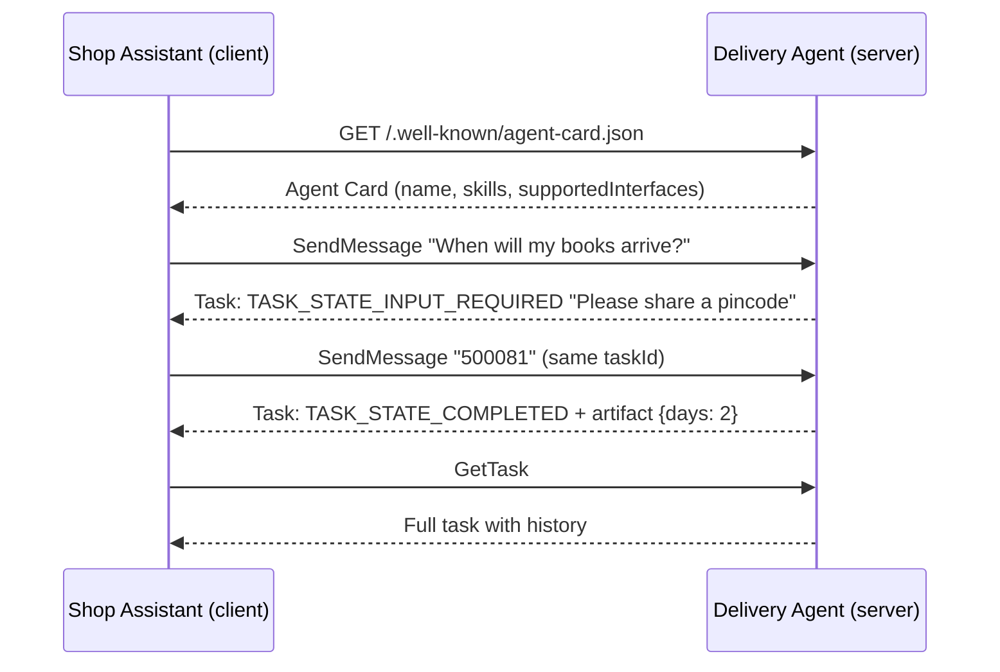
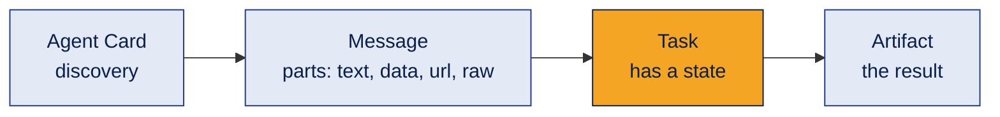
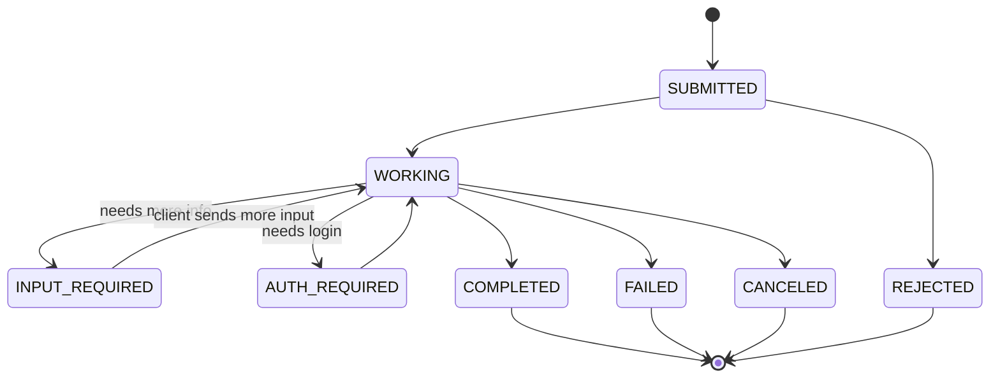

# A2A Protocol Demo: two agents talking

A small, runnable sample of the **A2A (Agent2Agent) protocol, version 1.0**. A Shop Assistant agent finds a Delivery Agent, asks it a question, gives more input when asked, and reads back a structured result.

The same demo is built **two ways**:

| Folder | How | Why |
|---|---|---|
| root | Python standard library only, JSON written by hand | You can **see** every JSON message. No installs, no API key |
| `sdk/` | Official A2A Python SDK (`a2a-sdk` 1.2.3) | How real projects build it. The SDK writes the JSON for you |

Both versions speak the same protocol, so they work together: the SDK client can talk to the hand written server and the other way round. I tested all four combinations.

## Contents
1. [What is A2A](#1-what-is-a2a)
2. [How it works](#2-how-it-works)
3. [The JSON on the wire](#3-the-json-on-the-wire)
4. [Run it](#4-run-it)
5. [Task states](#5-task-states)
6. [A2A vs MCP vs LangGraph](#6-a2a-vs-mcp-vs-langgraph)
7. [Common mistakes](#7-common-mistakes)
8. [Interview questions](#8-interview-questions)
9. [Summary](#9-summary)

---

## 1. What is A2A

A2A is an open protocol that lets **AI agents built by different teams, with different frameworks, talk to each other** in a standard way. One agent can be built with LangGraph, the other with CrewAI, and they still understand each other.

It was started by Google and is now governed under the Linux Foundation.

**Simple analogy:** every agent has a visiting card (the **Agent Card**) that says who it is and what it can do. Another agent reads the card, then sends a message in a common format (**JSON-RPC 2.0** over HTTP).

## 2. How it works





| Piece | Meaning |
|---|---|
| Agent Card | JSON at `/.well-known/agent-card.json`: name, description, skills, and `supportedInterfaces` (URL, binding, protocol version) |
| Message | One turn from `ROLE_USER` or `ROLE_AGENT`, made of parts (`text`, `data`, `url`, `raw`) |
| Task | A unit of work with an id and a state. Several messages can belong to one task |
| Artifact | The output of a task, for example structured JSON data |
| Methods used here | `SendMessage`, `GetTask` (others: `SendStreamingMessage`, `CancelTask`, push notification methods) |

## 3. The JSON on the wire

The client sends an HTTP header `A2A-Version: 1.0`. Without it, the server assumes the old version 0.3 and rejects the request.

**Request**
```json
{
  "jsonrpc": "2.0",
  "id": "1",
  "method": "SendMessage",
  "params": {
    "message": {
      "messageId": "f1c2...",
      "role": "ROLE_USER",
      "parts": [{ "text": "When will my books arrive?" }]
    }
  }
}
```

**Response (shortened)**
```json
{
  "jsonrpc": "2.0",
  "id": "1",
  "result": {
    "task": {
      "id": "0611f689...",
      "contextId": "9a7e...",
      "status": {
        "state": "TASK_STATE_INPUT_REQUIRED",
        "message": { "role": "ROLE_AGENT", "parts": [{ "text": "Please share a 6 digit pincode." }] }
      }
    }
  }
}
```

**Errors used in this demo**

| Code | Meaning |
|---|---|
| -32700 | Parse error (the body is not valid JSON) |
| -32601 | Method not found |
| -32602 | Invalid params |
| -32001 | Task not found (A2A specific) |
| -32009 | Version not supported (A2A specific) |

## 4. Run it

**Hand written version (no installs):**
```bash
python run_demo.py
```

Expected output:
```text
1. Found agent: Delivery Agent  |  skills: ['Estimate delivery']
2. Task 0611f689... state = TASK_STATE_INPUT_REQUIRED  |  agent says: Please share a 6 digit pincode.
3. Task 0611f689... state = TASK_STATE_COMPLETED  |  agent says: Delivery to 500081 takes about 2 days.
4. GetTask -> state = TASK_STATE_COMPLETED  |  artifact data = {'pincode': '500081', 'region': 'South (Telangana, Andhra Pradesh, Karnataka)', 'days': 2}
   Messages in task history: 4
```

Steps 2 and 3 show the **same task id**. That is how A2A handles multi turn work.

**SDK version:**
```bash
cd sdk
pip install -r requirements.txt
python delivery_agent_sdk.py      # terminal 1
python shop_assistant_sdk.py      # terminal 2
```

While a server runs, open the Agent Card in a browser: `http://127.0.0.1:8765/.well-known/agent-card.json` (hand written) or `http://127.0.0.1:9999/.well-known/agent-card.json` (SDK).

The delivery rule is made up for learning: pincodes starting with 5 take 2 days, with 6 take 3 days, others take 5 days.

## 5. Task states



On the wire each state has the prefix `TASK_STATE_`, for example `TASK_STATE_COMPLETED`. `COMPLETED`, `FAILED`, `CANCELED` and `REJECTED` are final: once a task reaches one of them, it does not change again. This demo answers instantly, so you only see `INPUT_REQUIRED` and `COMPLETED`.

## 6. A2A vs MCP vs LangGraph

| | What it connects | Example |
|---|---|---|
| **MCP** | An agent to **tools and data** | Agent reads a database through an MCP server |
| **A2A** | An agent to **another agent** | Shop agent asks a delivery agent from another company |
| **LangGraph / CrewAI** | Agents **inside one app** (orchestration) | Supervisor routes work between your own agents |

They work together: an agent built with LangGraph can use MCP for tools and A2A to talk to outside agents.

## 7. Common mistakes

1. **Starting a new task for a follow up.** If the agent asks for input, send the next message with the **same `taskId`**, or the agent loses the context.
2. **Forgetting the `A2A-Version` header.** A v1.0 server treats a request without it as version 0.3 and returns error -32009.
3. **Using old 0.3 names with a 1.0 server.** In 0.3 the method was `message/send` and the role was `"user"`. In 1.0 it is `SendMessage` and `ROLE_USER`.
4. **Hardcoding the endpoint.** Read the URL from `supportedInterfaces` in the Agent Card.
5. **Expecting integers back from the SDK.** Data parts travel as JSON objects, so the SDK returns numbers like `2.0`. Convert with `int()` if you need a whole number.
6. **No authentication.** This demo has none and only listens on `127.0.0.1`. Real agents must declare and check auth.

## 8. Interview questions

1. **What problem does A2A solve?** It lets agents from different vendors and frameworks communicate through one standard.
2. **How does a client discover an agent?** By reading its Agent Card at `/.well-known/agent-card.json`.
3. **What transport does A2A use?** HTTP with a binding such as JSON-RPC 2.0 (also gRPC and HTTP+JSON/REST). Streaming uses Server Sent Events.
4. **What is the difference between a message and an artifact?** A message is one conversational turn. An artifact is the output produced by the task.
5. **How is A2A different from MCP?** MCP connects an agent to tools and data. A2A connects an agent to other agents.

## 9. Summary

A2A gives agents a visiting card and a common language, so they can find each other, share tasks and return results, whatever framework they were built with.

---

**Version note:** This demo follows A2A **v1.0** and was tested with `a2a-sdk` 1.2.3. The spec moves fast, so check the official A2A documentation before building on it.

License: [MIT](LICENSE)
